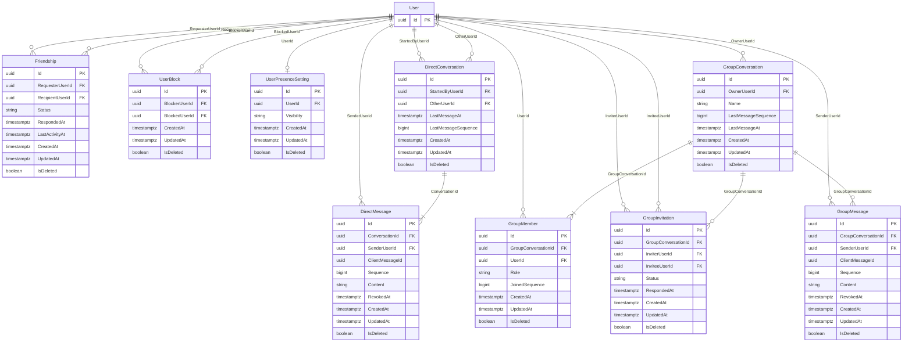

# Đặc tả chat realtime riêng/nhóm, kết bạn và trạng thái online

> Trạng thái: **thiết kế để triển khai**, chưa phải API hoặc database đang hoạt động.
> Phạm vi: chat văn bản 1–1 và chat nhóm giữa User, kể cả người lạ; kết bạn, chặn liên hệ, thu hồi tin nhắn và quản lý trạng thái online/offline của bạn bè. Không có ảnh/file, gọi thoại/video, typing indicator hoặc read receipt.

## 1. Căn cứ từ dự án

- [Thiết kế User và phân quyền](../docs/database/user-phan-quyen.md) định nghĩa `users.id` là `uuid`, `users.status`, `users.is_deleted`, `user_profiles`, `roles` và `user_roles`. User mới có role `CUSTOMER`; sau khi được duyệt làm chủ sân, cùng User đó có thêm role `OWNER`. Vì vậy người tham gia chat luôn là **User**, không phải `owner_profiles` hay hai loại tài khoản tách biệt.
- `ADMIN` không tham gia chat xã hội theo đặc tả này. User có cả `CUSTOMER` và `OWNER` vẫn là một người tham gia.
- [Report và report_messages](../docs/database/report.md) phục vụ báo cáo giữa người dùng và Admin với quyền, trạng thái riêng; không tái sử dụng làm tin nhắn chat.
- Code hiện có `AppDbContext`, JWT, `ICurrentUser` và các response chung, nhưng chưa có entity User, migration, endpoint đăng nhập, Hub hoặc bảng chat. `Features:Database` và `Features:Jwt` trong cấu hình hiện đang tắt. Các bảng dưới đây là **bảng cần tạo**, không phải schema đã tồn tại.
- Công nghệ phù hợp với cấu trúc hiện tại: PostgreSQL qua EF Core/Npgsql lưu dữ liệu lâu dài; ASP.NET Core SignalR phát sự kiện tới client đang kết nối; HTTP API lấy danh sách và đồng bộ lịch sử. Chat nhóm và presence trong tài liệu cũng chưa được triển khai.

## 2. Thuật ngữ và quy tắc sản phẩm

| Thuật ngữ | Nghĩa |
|---|---|
| User hợp lệ | `users.status = 'ACTIVE'`, `users.is_deleted = false`, có ít nhất một role `CUSTOMER` hoặc `OWNER` đang hoạt động. Kiểm tra từ database ở thao tác nhạy cảm, không chỉ tin claim role cũ trong JWT. |
| Người lạ | Hai User chưa có quan hệ bạn bè `ACCEPTED`. Người lạ vẫn được bắt đầu chat riêng hoặc mời vào nhóm. |
| Thành viên nhóm | User có `GroupMember.IsDeleted = false` trong group chưa giải tán; tư cách này cấp quyền chat nhóm nhưng không cấp quyền xem presence. |
| Bạn bè | Một cặp User có `friendships.status = 'ACCEPTED'`. Quan hệ không phụ thuộc vào việc đã chat hay chưa. |
| Đang kết nối | User có ít nhất một kết nối SignalR còn hoạt động, kể cả khi họ chọn ẩn trạng thái. Đây là trạng thái tạm thời do server xác định. |
| Hiển thị online | Tùy chọn bền vững do chính User đặt: `VISIBLE` (mặc định) hoặc `HIDDEN`. `HIDDEN` cho phép tiếp tục chat nhưng xuất hiện offline với người khác. |
| Online công khai | User hợp lệ **đang kết nối** và chọn `VISIBLE`. Chỉ bạn bè không bị chặn được xem; không thể tự chọn online khi không có kết nối. Trạng thái gần thời gian thực, không bảo đảm chính xác tức thời khi mạng mất đột ngột. |
| Thu hồi | Người gửi làm nội dung tin nhắn không còn hiển thị cho cả hai phía. Record và ID được giữ để đồng bộ thứ tự, nội dung được xóa khỏi field `Content`. |
| Chặn | Một User ngăn User kia gửi tin mới, gửi lời mời kết bạn và xem online của mình. Hai phía vẫn được xem lịch sử chat cũ của chính họ. |

Quy tắc mặc định cho bản đầu: chỉ chat văn bản; người gửi được thu hồi tin của mình bất kỳ lúc nào; bạn bè mới thấy online; mỗi User được tự ẩn/hiện trạng thái online. Một chiều chặn ngăn chat riêng và lời mời giữa hai User; thành viên vẫn nhìn thấy tin của nhau trong nhóm chung theo chính sách nhóm ở mục 3.9. Nếu chính sách sản phẩm thay đổi, cập nhật tài liệu và kiểm thử quyền trước khi triển khai.

## 3. Database

### 3.1. Sơ đồ ER cho riêng chat realtime

`User` trong sơ đồ chỉ là **tham chiếu `Id` tới bảng `users` đã được thiết kế ở tài liệu phân quyền**; không mô tả lại database User/Auth. Chín entity còn lại là phần cần thêm cho chat và presence. Sơ đồ thể hiện quan hệ và field; các ràng buộc unique, CHECK, nullable và index được nêu ngay bên dưới.

### 3.2. Quy ước chung

- Tên field trong sơ đồ và bảng sau là **property PascalCase của entity C#**. Khi map bằng EF Core, cột PostgreSQL dùng `snake_case` theo tài liệu database hiện có: ví dụ `RequesterUserId` ↔ `requester_user_id`, `LastMessageSequence` ↔ `last_message_sequence`. Các biểu thức index và `CHECK` bên dưới ghi bằng tên property để dễ đọc, **không phải SQL có thể chạy trực tiếp**; migration phải dùng tên cột đã map. JSON API tiếp tục dùng `camelCase` theo convention của ASP.NET Core.
- Tên bảng PostgreSQL giữ `friendships`, `user_blocks`, `user_presence_settings`, `direct_conversations`, `direct_messages`, `group_conversations`, `group_members`, `group_invitations`, `group_messages`; không tạo bảng User mới cho chat.
- PostgreSQL `uuid` dùng cho ID, `timestamptz` dùng cho thời gian UTC; API trả ISO 8601 UTC.
- Giữ FK tới `users.id` với `ON DELETE RESTRICT`, phù hợp soft delete của User hiện có.
- `Friendship` lưu người gửi và người nhận lời mời; `DirectConversation` lưu người gửi tin đầu tiên và người còn lại. Vị trí hai User trong row không ảnh hưởng quyền chat. Unique index trên `LEAST`/`GREATEST` của hai ID bảo đảm một cặp chỉ có một row bất kể chiều khởi tạo.
- Cả chín entity có `CreatedAt`, `UpdatedAt` và `IsDeleted` như quy ước chung của dự án. `IsDeleted` mặc định `false`. `Friendship` dùng soft delete khi hủy kết bạn; `UserBlock` dùng khi bỏ chặn; `GroupMember` dùng khi rời/bị xóa khỏi nhóm; `GroupConversation` dùng khi giải tán. Không có thao tác xóa chat riêng hay message; thu hồi tin dùng `RevokedAt` và giữ row để đồng bộ `Sequence`.
- Unique constraint/index là lớp bảo vệ cuối cùng trước hai request đồng thời. Service vẫn phải kiểm tra và trả lỗi nghiệp vụ có nghĩa.

### 3.3. `friendships` — quan hệ bạn bè và lời mời

| Field | PostgreSQL type | Nullable | Key / default / nghĩa |
|---|---|---:|---|
| `Id` | `uuid` | No | PK, `gen_random_uuid()` |
| `RequesterUserId` | `uuid` | No | FK → `users.id`; người gửi lời mời gần nhất |
| `RecipientUserId` | `uuid` | No | FK → `users.id`; người nhận lời mời gần nhất |
| `Status` | `varchar(20)` | No | `PENDING`, `ACCEPTED`, `REJECTED`, `CANCELLED` |
| `RespondedAt` | `timestamptz` | Yes | Thời điểm xử lý lời mời; `NULL` khi `PENDING` |
| `LastActivityAt` | `timestamptz` | No | Default `now()`; cập nhật khi gửi lại hoặc đổi trạng thái, dùng sắp xếp danh sách |
| `CreatedAt` | `timestamptz` | No | Default `now()` |
| `UpdatedAt` | `timestamptz` | Yes | Cập nhật khi đổi trạng thái hoặc gửi lại |
| `IsDeleted` | `boolean` | No | Default `false`; `true` khi hủy kết bạn |

**Constraints/indexes**

- `CHECK (RequesterUserId <> RecipientUserId)`; không thể tự kết bạn. Unique **expression index** trên `(LEAST(RequesterUserId, RecipientUserId), GREATEST(RequesterUserId, RecipientUserId))` bảo đảm một row cho cặp bất kể ai gửi lời mời. Index áp dụng cả row `IsDeleted = true` để lúc mời lại phải restore row cũ.
- `PENDING` yêu cầu `RespondedAt IS NULL`; các trạng thái còn lại yêu cầu `RespondedAt IS NOT NULL`.
- Index `(RequesterUserId, Status, LastActivityAt DESC, Id DESC)` và `(RecipientUserId, Status, LastActivityAt DESC, Id DESC)` với `IsDeleted = false` phục vụ danh sách bạn bè và lời mời đã gửi/đã nhận.

**Chuyển trạng thái**

| Từ | Hành động | Sang | Người được thực hiện |
|---|---|---|---|
| Chưa có row, `REJECTED`, `CANCELLED`, hoặc row đã soft-delete | Gửi lời mời | `PENDING` | Người gửi mới; đặt lại `RequesterUserId`, `RecipientUserId`, `RespondedAt = NULL`, `IsDeleted = false` |
| `PENDING` | Chấp nhận / từ chối | `ACCEPTED` / `REJECTED` | Chỉ người **nhận** lời mời |
| `PENDING` | Hủy lời mời | `CANCELLED` | Chỉ người **gửi** |
| `ACCEPTED` | Hủy kết bạn | `IsDeleted = true` | Một trong hai User; giữ `Status = ACCEPTED` để biết trạng thái trước khi xóa |

Không tạo row thứ hai khi tái gửi; tìm cả row soft-delete, cập nhật row cũ trong transaction. Mọi chuyển trạng thái cập nhật `LastActivityAt` và `UpdatedAt`; khi rời `PENDING` thì đặt `RespondedAt`, khi mời lại thì xóa `RespondedAt`. Với request đồng thời, unique pair và kiểm tra trạng thái sau xung đột bảo đảm chỉ một lời mời đang chờ. Không cho gửi lại khi `PENDING` hoặc `ACCEPTED` còn hiệu lực. Bộ lọc trạng thái chỉ phản ánh **trạng thái hiện tại** của row chưa soft-delete, không phải lịch sử mọi lần mời.

### 3.4. `user_blocks` — chặn liên hệ

| Field | PostgreSQL type | Nullable | Key / default / nghĩa |
|---|---|---:|---|
| `Id` | `uuid` | No | PK, `gen_random_uuid()` |
| `BlockerUserId` | `uuid` | No | FK → `users.id` |
| `BlockedUserId` | `uuid` | No | FK → `users.id` |
| `CreatedAt` | `timestamptz` | No | Default `now()` |
| `UpdatedAt` | `timestamptz` | Yes |  |
| `IsDeleted` | `boolean` | No | Default `false`; `true` khi bỏ chặn |

- `CHECK (BlockerUserId <> BlockedUserId)`; `UNIQUE (BlockerUserId, BlockedUserId)` để bỏ chặn rồi chặn lại bằng cách restore record cũ.
- Index `(BlockedUserId, BlockerUserId) WHERE IsDeleted = false` để kiểm tra chiều ngược. Unique pair đã phục vụ chiều thuận.
- Nếu một trong hai chiều có block đang hoạt động: từ chối gửi tin riêng mới, gửi/chấp nhận lời mời kết bạn và gửi lời mời nhóm mới giữa hai User; không công bố presence giữa hai User. Khi block, lời mời kết bạn `PENDING` giữa họ chuyển `CANCELLED` trong cùng transaction. Quan hệ bạn bè `ACCEPTED` được soft-delete (`IsDeleted = true`). Lời mời nhóm pending do blocker gửi tới blocked hoặc ngược lại cũng chuyển `CANCELLED`; membership nhóm hiện có không đổi.
- Một thao tác gửi đã bắt đầu trước khi transaction block commit có thể hoàn tất; block áp dụng cho thao tác bắt đầu sau khi commit. Client phải bỏ qua sự kiện presence cũ sau khi biết trạng thái block.

### 3.5. `user_presence_settings` — quyền hiển thị trạng thái

| Field | PostgreSQL type | Nullable | Key / default / nghĩa |
|---|---|---:|---|
| `Id` | `uuid` | No | PK, `gen_random_uuid()` |
| `UserId` | `uuid` | No | FK → `users.id`, UNIQUE; chủ cài đặt |
| `Visibility` | `varchar(20)` | No | `VISIBLE` hoặc `HIDDEN`; mặc định `VISIBLE` |
| `CreatedAt` | `timestamptz` | No | Default `now()` |
| `UpdatedAt` | `timestamptz` | Yes | Thời điểm đổi tùy chọn |
| `IsDeleted` | `boolean` | No | Default `false`; không có API xóa ở bản đầu |

- `CHECK (Visibility IN ('VISIBLE', 'HIDDEN'))`; `UNIQUE (UserId)` kể cả row soft-delete. Nếu chưa có row thì coi là `VISIBLE`; tạo row khi User đổi cài đặt lần đầu.
- Không lưu `IsOnline` trong PostgreSQL. Trạng thái online công khai = User hợp lệ + `Visibility = VISIBLE` + số kết nối SignalR còn sống > 0. `HIDDEN` chỉ thay đổi cách người khác nhìn thấy User; Hub, gửi/nhận tin và thông báo vẫn hoạt động.
- `User.Status` (`ACTIVE`/`SUSPENDED`...) là trạng thái tài khoản, độc lập với presence và không được dùng thay cho tùy chọn này. Không cung cấp `LastSeenAt` ở bản đầu để tránh vô tình tiết lộ hoạt động khi User chọn `HIDDEN`.

### 3.6. `direct_conversations` — một cuộc chat cho một cặp

| Field | PostgreSQL type | Nullable | Key / default / nghĩa |
|---|---|---:|---|
| `Id` | `uuid` | No | PK, `gen_random_uuid()` |
| `StartedByUserId` | `uuid` | No | FK → `users.id`; người gửi tin nhắn đầu tiên |
| `OtherUserId` | `uuid` | No | FK → `users.id`; người nhận tin nhắn đầu tiên |
| `LastMessageAt` | `timestamptz` | No | Thời điểm tin cuối, dùng sắp xếp inbox |
| `LastMessageSequence` | `bigint` | No | Số thứ tự tin cuối của cuộc trò chuyện; bắt đầu từ `1` |
| `CreatedAt` | `timestamptz` | No | Default `now()` |
| `UpdatedAt` | `timestamptz` | Yes | Cập nhật khi có tin mới |
| `IsDeleted` | `boolean` | No | Default `false`; bản đầu không có API xóa conversation |

- `CHECK (StartedByUserId <> OtherUserId)`. Unique **expression index** trên `(LEAST(StartedByUserId, OtherUserId), GREATEST(StartedByUserId, OtherUserId))` bảo đảm một conversation cho cặp, kể cả hai người gửi tin đầu tiên đồng thời. Index áp dụng cả row soft-delete để không tạo conversation thứ hai chứa cùng lịch sử.
- Conversation chỉ được tạo trong transaction tạo tin đầu tiên; vì vậy sau commit luôn có ít nhất một message và `LastMessageAt` hợp lệ.
- `CHECK (LastMessageSequence >= 1)`. Index `(StartedByUserId, LastMessageAt DESC, Id DESC)` và `(OtherUserId, LastMessageAt DESC, Id DESC)` với `IsDeleted = false` cho hai chiều inbox. Truy vấn inbox lấy tối đa `pageIndex * pageSize` conversation từ mỗi chiều rồi hợp nhất/sắp xếp và chọn trang cần trả, tránh quét toàn bộ message hoặc N+1. Sau khi có một trang conversation, lấy preview tin cuối bằng truy vấn batch theo các ID đó. Trang quá sâu vẫn tốn chi phí tương ứng với `pageIndex`.
- Khi tạo message mới, khóa row conversation, cấp `Sequence = LastMessageSequence + 1` rồi cập nhật `LastMessageSequence` và `LastMessageAt` trong **cùng transaction**. Transaction gửi tiếp theo chờ khóa nên số thứ tự không trùng và tăng theo thứ tự commit của cuộc trò chuyện. Với tin đầu tiên, tạo conversation cùng `LastMessageSequence = 1`.
- Thu hồi không đổi `LastMessageAt`: tin thu hồi vẫn là một phần của lịch sử và thứ tự inbox.
- `IsDeleted` luôn `false` trong bản đầu. Không dùng cờ này cho thao tác “ẩn chat của riêng tôi”, vì xóa ở row chung sẽ ẩn chat của cả hai User. Nếu sau này cần ẩn riêng từng User, phải thiết kế trạng thái theo từng thành viên.

### 3.7. `direct_messages` — tin nhắn văn bản

| Field | PostgreSQL type | Nullable | Key / default / nghĩa |
|---|---|---:|---|
| `Id` | `uuid` | No | PK, `gen_random_uuid()` |
| `ConversationId` | `uuid` | No | FK → `direct_conversations.id` |
| `SenderUserId` | `uuid` | No | FK → `users.id` |
| `ClientMessageId` | `uuid` | No | ID do client tạo cho **một lần soạn/gửi**, giữ nguyên khi retry |
| `Sequence` | `bigint` | No | Số thứ tự tăng dần trong conversation, do server cấp |
| `Content` | `varchar(2000)` | Yes | Text đã trim; `NULL` sau thu hồi |
| `RevokedAt` | `timestamptz` | Yes | `NULL` khi chưa thu hồi |
| `CreatedAt` | `timestamptz` | No | Default `now()` |
| `UpdatedAt` | `timestamptz` | Yes |  |
| `IsDeleted` | `boolean` | No | Default `false`; bản đầu không có API xóa message |

- `UNIQUE (SenderUserId, ClientMessageId)` chống tạo tin trùng khi client retry. ID đã dùng luôn chỉ tới kết quả lần gửi đầu tiên; request lặp không được sửa tin. Nếu cùng ID nhưng `targetUserId` khác, trả `409`. Server không so sánh lại nội dung vì tin đầu tiên có thể đã được thu hồi và `Content` đã bị xóa.
- `CHECK`: khi `RevokedAt IS NULL`, `Content` phải khác `NULL` và `length(btrim(Content)) BETWEEN 1 AND 2000`; khi `RevokedAt IS NOT NULL`, `Content IS NULL` và `RevokedAt >= CreatedAt`.
- `CHECK (Sequence >= 1)`; `UNIQUE (ConversationId, Sequence)`. Index `(ConversationId, Sequence DESC)` hỗ trợ trang lịch sử mới nhất. Số thứ tự vẫn được giữ khi thu hồi; không xóa vật lý message.
- `SenderUserId` phải là `StartedByUserId` hoặc `OtherUserId` của conversation; ràng buộc liên bảng này được service kiểm tra trong transaction và được kiểm thử. API không nhận sender từ client.
- Chỉ sender được thu hồi. Thu hồi lần hai là idempotent: trả record đã thu hồi, không phát sự kiện lần hai. Không trả nội dung cũ qua bất kỳ API nào sau thu hồi.
- `Sequence` là thứ tự hiển thị xác định trong từng conversation. Client khử trùng theo `Id` và chỉ dùng `CreatedAt` làm thời gian hiển thị. Chi phí đánh đổi là các lần gửi vào **cùng** conversation phải tuần tự tại row conversation; điều này phù hợp chat 1–1, nhưng cần đo khi tải tăng.
- `IsDeleted` luôn `false` trong bản đầu; thu hồi dùng `RevokedAt` và `Content = NULL`, không soft-delete message. Nhờ vậy row và `Sequence` vẫn có mặt khi đồng bộ theo trang.

### 3.8. Quan hệ và entity trong code

| Entity dự kiến | Quan hệ |
|---|---|
| `Friendship` | `RequesterUserId` và `RecipientUserId` là hai FK tới `User`; chiều có thể đổi khi tái gửi lời mời |
| `UserBlock` | `User` chặn → `User` bị chặn |
| `UserPresenceSetting` | 1–0..1 với `User`; cài đặt hiển thị bền vững |
| `DirectConversation` | `StartedByUserId` và `OtherUserId` là hai FK tới `User`; 1–N `DirectMessage` |
| `DirectMessage` | N–1 conversation; N–1 sender `User` |
| `GroupConversation` | N–1 owner `User`; 1–N member, invitation, message |
| `GroupMember` | N–1 group, N–1 `User`; role và mốc bắt đầu đọc lịch sử |
| `GroupInvitation` | N–1 group, N–1 inviter và invitee `User` |
| `GroupMessage` | N–1 group; N–1 sender `User` |

Không cần bảng `online_users` trong PostgreSQL. Số kết nối là trạng thái tạm thời; chỉ tùy chọn `Visibility` được lưu lâu dài. Chat riêng không cần bảng participant: hai FK trên conversation đã biểu diễn đủ thành viên; unique index ngăn cặp đảo chiều. Chat nhóm dùng bảng thành viên riêng ở mục 3.9.

### 3.9. Chat nhóm

Nhóm là aggregate độc lập với chat riêng. Không ghép cặp User vào `DirectConversation` để mô phỏng nhóm. Chỉ User `ACTIVE` có role `CUSTOMER` hoặc `OWNER` được tạo, nhận lời mời và tham gia nhóm. Người lạ có thể mời nhau vào nhóm; người được mời phải tự chấp nhận. `ADMIN` không tham gia.

**`group_conversations`**

| Field | PostgreSQL type | Nullable | Key / default / nghĩa |
|---|---|---:|---|
| `Id` | `uuid` | No | PK |
| `OwnerUserId` | `uuid` | No | FK → `users.id`; chủ nhóm hiện tại |
| `Name` | `varchar(100)` | No | Tên đã trim, 1–100 ký tự |
| `LastMessageSequence` | `bigint` | No | Default `0`; tăng trong transaction gửi tin |
| `LastMessageAt` | `timestamptz` | Yes | `NULL` nếu chưa có tin |
| `CreatedAt` | `timestamptz` | No | Default `now()` |
| `UpdatedAt` | `timestamptz` | Yes | Khi đổi tên/owner hoặc có tin |
| `IsDeleted` | `boolean` | No | Default `false`; chỉ owner được giải tán nhóm |

`CHECK (LastMessageSequence >= 0)`; `CHECK (length(btrim(Name)) BETWEEN 1 AND 100)`. Owner phải là member `OWNER` chưa soft-delete; tạo group và member owner cùng transaction. Khi chuyển quyền, cập nhật owner cũ, owner mới và `OwnerUserId` cùng transaction. Giải tán nhóm đóng quyền gửi/đọc bằng API thông thường; không xóa vật lý dữ liệu. Index `(OwnerUserId)` phục vụ quản trị.

**`group_members`**

| Field | PostgreSQL type | Nullable | Key / default / nghĩa |
|---|---|---:|---|
| `Id` | `uuid` | No | PK |
| `GroupConversationId` | `uuid` | No | FK → `group_conversations.id` |
| `UserId` | `uuid` | No | FK → `users.id` |
| `Role` | `varchar(20)` | No | `OWNER` hoặc `MEMBER` |
| `JoinedSequence` | `bigint` | No | Sequence đầu tiên được đọc; lúc nhận lời mời = `LastMessageSequence + 1` |
| `CreatedAt` | `timestamptz` | No | Default `now()` |
| `UpdatedAt` | `timestamptz` | Yes | Khi đổi role hoặc rời/vào lại |
| `IsDeleted` | `boolean` | No | Default `false`; rời/bị xóa |

`UNIQUE (GroupConversationId, UserId)` áp dụng cả row đã xóa để tái tham gia bằng restore; `CHECK (JoinedSequence >= 1)`; `CHECK (Role IN ('OWNER', 'MEMBER'))`. Index `(UserId, IsDeleted, GroupConversationId)` cho inbox nhóm và `(GroupConversationId, IsDeleted, UserId)` cho danh sách thành viên. Chủ nhóm không thể rời/bị xóa khi chưa chuyển quyền hoặc giải tán. Khi tái tham gia, đặt lại `JoinedSequence`; không cấp lại lịch sử cũ.

**`group_invitations`**

| Field | PostgreSQL type | Nullable | Key / default / nghĩa |
|---|---|---:|---|
| `Id` | `uuid` | No | PK |
| `GroupConversationId` | `uuid` | No | FK → group |
| `InviterUserId` | `uuid` | No | FK → `users.id`; member gửi mời |
| `InviteeUserId` | `uuid` | No | FK → `users.id`; người được mời |
| `Status` | `varchar(20)` | No | `PENDING`, `ACCEPTED`, `REJECTED`, `CANCELLED` |
| `RespondedAt` | `timestamptz` | Yes | `NULL` khi pending |
| `CreatedAt` | `timestamptz` | No | Default `now()` |
| `UpdatedAt` | `timestamptz` | Yes | Khi xử lý hoặc mời lại |
| `IsDeleted` | `boolean` | No | Default `false`; không có API xóa ở bản đầu |

`UNIQUE (GroupConversationId, InviteeUserId)` kể cả row đã xóa; mời lại chỉ cập nhật row cũ. `PENDING` yêu cầu `RespondedAt IS NULL`, trạng thái khác yêu cầu giá trị. Index `(InviteeUserId, Status, CreatedAt DESC, Id DESC)` phục vụ inbox lời mời. Chỉ member hiện hành mời được; nếu một chiều block giữa người mời và người nhận thì từ chối. Chỉ invitee chấp nhận/từ chối; người mời hoặc owner có thể hủy. Khi chấp nhận, khóa invitation và group, kiểm tra trạng thái, tạo/restore member với `JoinedSequence = LastMessageSequence + 1`, rồi chuyển `ACCEPTED` trong cùng transaction. Nếu invitee đã là member, trả `409`. Khi giải tán nhóm, hủy các lời mời pending trong cùng transaction; lời mời của nhóm đã giải tán không thể được chấp nhận.

**`group_messages`**

| Field | PostgreSQL type | Nullable | Key / default / nghĩa |
|---|---|---:|---|
| `Id` | `uuid` | No | PK |
| `GroupConversationId` | `uuid` | No | FK → group |
| `SenderUserId` | `uuid` | No | FK → `users.id` |
| `ClientMessageId` | `uuid` | No | UUID giữ nguyên khi retry |
| `Sequence` | `bigint` | No | Thứ tự trong nhóm |
| `Content` | `varchar(2000)` | Yes | `NULL` sau thu hồi |
| `RevokedAt` | `timestamptz` | Yes | Thời điểm thu hồi |
| `CreatedAt` | `timestamptz` | No | Default `now()` |
| `UpdatedAt` | `timestamptz` | Yes | Khi thu hồi |
| `IsDeleted` | `boolean` | No | Default `false`; bản đầu không xóa message |

`UNIQUE (SenderUserId, ClientMessageId)`, `UNIQUE (GroupConversationId, Sequence)`; index `(GroupConversationId, Sequence DESC)`. Ràng buộc nội dung/thu hồi giống `direct_messages`. Sender phải là member đang hoạt động tại thời điểm gửi; cấp `Sequence` bằng khóa row group trong transaction. Chỉ sender thu hồi; người mới vào không được xem tin có `Sequence < JoinedSequence`. Khi member rời/bị xóa, họ mất quyền đọc toàn bộ group qua API và không nhận event mới. Block cá nhân không tự xóa membership hoặc giấu tin trong nhóm chung; UI phải thể hiện rõ chính sách này.

## 4. HTTP API contract

Tất cả route dưới đây yêu cầu JWT của User hợp lệ. `currentUserId` luôn lấy từ token đã xác thực. Response danh sách dùng `PagedApiResponse<T>` hiện có; lỗi dùng `ApiErrorResponse`. Mọi API danh sách dùng `pageIndex` (bắt đầu từ `1`, mặc định `1`) và `pageSize` (mặc định `20`, tối đa `100`) theo `PaginationRequest` hiện có. Filter tùy chọn được áp dụng **trước** khi tính `TotalCount` và phân trang. Ví dụ mã lỗi: `USER_NOT_AVAILABLE`, `CHAT_BLOCKED`, `CONVERSATION_FORBIDDEN`, `MESSAGE_NOT_FOUND`, `MESSAGE_NOT_OWNED`, `FRIEND_REQUEST_CONFLICT`.

| Method | Route | Request / response chính |
|---|---|---|
| `POST` | `/api/friendships/requests` | `{ targetUserId }` → friendship; `409` nếu đang pending/accepted; `403` nếu bị chặn |
| `GET` | `/api/friendships?pageIndex=1&pageSize=20&search=` | Danh sách bạn bè `ACCEPTED`; `search` tùy chọn lọc theo username/full name công khai; gồm `isOnline` hiện tại |
| `GET` | `/api/presence/me` | `{ visibility, isConnected }`; chỉ chính User xem kết nối thật của mình |
| `PATCH` | `/api/presence/me` | `{ visibility: "VISIBLE" | "HIDDEN" }` → cài đặt mới và `isOnline` công khai; idempotent |
| `GET` | `/api/friendships/requests?pageIndex=1&pageSize=20&direction=received&status=PENDING` | Lời mời của User; `direction` là `received` (mặc định) hoặc `sent`; `status` mặc định `PENDING`, có thể lọc một trạng thái hiện tại khác |
| `POST` | `/api/friendships/requests/{id}/accept` | Chỉ người nhận; chuyển `ACCEPTED` |
| `POST` | `/api/friendships/requests/{id}/reject` | Chỉ người nhận; chuyển `REJECTED` |
| `POST` | `/api/friendships/requests/{id}/cancel` | Chỉ người gửi; chuyển `CANCELLED` |
| `DELETE` | `/api/friendships/{id}` | Một trong hai người; soft-delete quan hệ `ACCEPTED` bằng `IsDeleted = true` |
| `PUT` | `/api/users/{targetUserId}/block` | Chặn hoặc trả trạng thái đã chặn; idempotent |
| `DELETE` | `/api/users/{targetUserId}/block` | Bỏ chặn; idempotent |
| `GET` | `/api/conversations?pageIndex=1&pageSize=20&otherUserId=` | Inbox của chính User, mới nhất trước; `otherUserId` tùy chọn lọc một đối phương; gồm profile, `lastMessageAt`, `lastMessageSequence`, preview tin cuối và `isOnline` **chỉ nếu là bạn bè** |
| `GET` | `/api/conversations/{id}` | Chi tiết một conversation của chính User, gồm `lastMessageSequence` để chốt mốc đồng bộ |
| `GET` | `/api/conversations/{id}/messages?pageIndex=1&pageSize=20&senderUserId=&isRevoked=` | Lịch sử chat, `sequence DESC` (mới nhất trước); hai filter tùy chọn, chỉ hai thành viên được đọc |
| `GET` | `/api/conversations/{id}/messages?pageIndex=1&pageSize=20&sequenceFrom=101&sequenceTo=150&sort=asc` | Đồng bộ một khoảng sequence cố định sau reconnect; chỉ hai thành viên được đọc |
| `POST` | `/api/groups` | `{ name }` → group và owner membership |
| `GET` | `/api/groups?pageIndex=1&pageSize=20&search=` | Group hiện tham gia, sắp `LastMessageAt DESC NULLS LAST, Id DESC`; `search` lọc tên nhóm |
| `GET` | `/api/groups/{id}` | Chi tiết group, role của mình, `joinedSequence`, `lastMessageSequence`; chỉ member |
| `PATCH` | `/api/groups/{id}` | Owner đổi `{ name }` |
| `DELETE` | `/api/groups/{id}` | Owner giải tán group, soft-delete group |
| `GET` | `/api/groups/{id}/members?pageIndex=1&pageSize=20&search=` | Member hiện hành; chỉ member đọc; online của từng người chỉ hiện nếu là bạn bè |
| `POST` | `/api/groups/{id}/invitations` | Member mời `{ targetUserId }`; `409` nếu đã là member hoặc đang pending |
| `GET` | `/api/groups/invitations?pageIndex=1&pageSize=20&status=PENDING` | Lời mời nhận; filter trạng thái |
| `POST` | `/api/groups/invitations/{invitationId}/accept` | Invitee chấp nhận và vào nhóm |
| `POST` | `/api/groups/invitations/{invitationId}/reject` | Invitee từ chối |
| `POST` | `/api/groups/invitations/{invitationId}/cancel` | Inviter hoặc owner hủy |
| `DELETE` | `/api/groups/{id}/members/me` | Member rời nhóm; owner phải chuyển quyền trước |
| `DELETE` | `/api/groups/{id}/members/{userId}` | Owner xóa member khác |
| `PUT` | `/api/groups/{id}/owner` | Owner chuyển quyền `{ targetUserId }` cho member hiện hành |
| `GET` | `/api/groups/{id}/messages?pageIndex=1&pageSize=20&senderUserId=&isRevoked=` | Lịch sử từ `joinedSequence` trở đi; chỉ member hiện hành |
| `GET` | `/api/groups/{id}/messages?pageIndex=1&pageSize=20&sequenceFrom=101&sequenceTo=150&sort=asc` | Đồng bộ khoảng cố định sau reconnect, chặn `sequenceFrom < joinedSequence` |

`sequenceFrom` và `sequenceTo` là filter **bao gồm hai đầu**, không phải cursor phân trang. `sort` mặc định `desc`, nhận `asc` cho đồng bộ. Validate `sequenceFrom >= 1`, `sequenceTo >= sequenceFrom` và chỉ chấp nhận `senderUserId` là một trong hai thành viên. Khi đồng bộ, không dùng `isRevoked` hoặc filter sender vì chúng có thể đổi tập kết quả hoặc bỏ sót tin. Mọi danh sách sắp xếp thêm khóa duy nhất (`Id` với friendship/conversation, `Sequence` với message) để trang có thứ tự xác định. Tin đã thu hồi vẫn được trả với `content: null`, `revokedAt` có giá trị. Không trả `password_hash`, email hoặc dữ liệu riêng của profile trong response chat.

Danh sách lời mời sắp theo `LastActivityAt DESC, Id DESC`; danh sách bạn bè cũng theo cặp này. Inbox sắp `LastMessageAt DESC, Id DESC`. Truy vấn dùng `COUNT` và `OFFSET`/`LIMIT` sau khi lọc; các trang sâu và bộ lọc `search` rộng có thể tốn chi phí. Vì một lời mời tái sử dụng cùng row, `Status` chỉ cho biết trạng thái hiện tại của cặp, không truy vấn được lịch sử mọi lần mời. Sau khi client xử lý lời mời hoặc nhận `FriendshipChanged`, tải lại trang 1 và tổng số. Một danh sách đang thay đổi có thể làm trang theo `pageIndex` lặp hoặc bỏ qua mục; client khử trùng theo ID và tải lại khi cần. Khoảng `sequenceFrom`–`sequenceTo` cố định giữ số lượng message ổn định vì message không bị xóa vật lý.

Không cần HTTP endpoint gửi tin ở bản đầu: `SendMessage`/`SendGroupMessage` trên Hub là đường ghi duy nhất. Nếu sau này cần client không hỗ trợ SignalR, HTTP endpoint phải gọi cùng application service.

## 5. SignalR contract

Hub `/hubs/chat`, yêu cầu JWT. SignalR mặc định dùng claim `ClaimTypes.NameIdentifier` làm `Context.UserIdentifier`; mã nguồn JWT/`CurrentUser` hiện cũng dùng claim này. Server gửi bằng `Clients.User(userId.ToString())` tới **mọi** tab/thiết bị của mỗi User. Không nhận `senderUserId` hoặc `connectionId` từ client. Không dùng group membership làm bằng chứng phân quyền.

| Hướng | Method / event | Payload tối thiểu và quy tắc |
|---|---|---|
| Client → server | `SendMessage(targetUserId, clientMessageId, content)` | Validate, kiểm tra block, lấy/tạo conversation, lưu message và cập nhật inbox; trả `{ conversationId, messageId, sequence, createdAt, revokedAt }`. |
| Server → hai User | `MessageCreated` | `{ id, conversationId, sequence, senderUserId, clientMessageId, content, createdAt }`; chỉ phát cho tin vừa tạo, không phát lại vì retry. |
| Client → server | `RecallMessage(messageId)` | Chỉ sender; trả `{ messageId, revokedAt }`. |
| Client → server | `SendGroupMessage(groupId, clientMessageId, content)` | Chỉ member hiện hành; lưu trước khi phát; ack gồm `groupId, messageId, sequence, createdAt`. |
| Client → server | `RecallGroupMessage(messageId)` | Chỉ sender; idempotent, xóa `Content` và giữ tombstone. |
| Server → member hiện hành | `GroupMessageCreated` / `GroupMessageRecalled` | Payload cùng nguyên tắc direct message, có `groupId`; server lấy danh sách member được phép ở thời điểm phát, không tin group membership của client. |
| Server → User liên quan | `GroupChanged` / `GroupInvitationChanged` | Chỉ metadata `groupId`/`invitationId` và loại thay đổi; client tải lại snapshot có phân quyền. |
| Server → hai User | `MessageRecalled` | `{ conversationId, messageId, revokedAt }`; client thay nội dung bằng dấu đã thu hồi. |
| Server → User liên quan | `FriendshipChanged` | `{ friendshipId, otherUserId, status }`; client tải lại danh sách nếu cần. |
| Server → bạn bè được phép | `PresenceChanged` | `{ userId, isOnline }`; khi online công khai đổi do kết nối, thay đổi `Visibility` hoặc khóa tài khoản. Không phát lúc mở/đóng tab phụ nếu kết quả không đổi. |

Hub xác thực và chuyển yêu cầu vào application service; business rule và transaction không nằm trong Hub. Sau khi transaction commit, server mới phát event. `MessageCreated` và `MessageRecalled` là **thông báo**, không phải nguồn dữ liệu chuẩn; database và API đồng bộ quyết định trạng thái cuối cùng. Client phải xử lý event lặp và event đến khác thứ tự bằng message ID và `sequence`.

## 6. Luồng hoạt động

### 6.1. Kết nối, offline tự động và ẩn/hiện trạng thái

1. Client đăng nhập, có JWT hợp lệ, kết nối `/hubs/chat` qua HTTPS/WSS.
2. Hub xác thực User còn hợp lệ, lấy User ID từ claim; đăng ký connection ID vào tập kết nối của User bằng thao tác an toàn khi có nhiều request đồng thời.
3. Server theo dõi tập connection ID riêng cho từng User. Kết nối đầu tiên làm User **đang kết nối**. Nếu `Visibility = VISIBLE`, phát `PresenceChanged(true)` tới bạn bè còn được phép xem. Nếu `HIDDEN`, không phát. Hai tab/thiết bị trở lên vẫn chỉ là một User online.
4. User gọi `PATCH /api/presence/me` để chọn `HIDDEN` hoặc `VISIBLE`. Server lưu tùy chọn và `UpdatedAt`, tính lại online công khai với số kết nối hiện tại, rồi phát `PresenceChanged` **sau commit** nếu giá trị công khai đổi. Chọn `HIDDEN` không đóng Hub; chọn `VISIBLE` khi không có kết nối vẫn hiển thị offline. Request lặp cùng giá trị không phát event.
5. Khi một tab ngắt, chỉ phát offline nếu đó là kết nối cuối **và** trạng thái công khai trước đó là online. Mất mạng đột ngột được xác định qua SignalR keepalive/timeout nên có độ trễ; server gỡ connection trong `OnDisconnectedAsync`. Khi process crash, client khác có thể chưa nhận event offline: UI tải lại snapshot lúc mở màn hình, reconnect và định kỳ khi đang hiển thị danh sách bạn bè.
6. Client đăng ký listener trước khi tải snapshot. Sau kết nối/reconnect, tải lại trang bạn bè/inbox để lấy presence mới nhất; event có thể bị trễ hoặc mất. Đồng bộ messages direct/group theo khoảng `sequenceFrom`–`sequenceTo` và các trang `pageIndex`/`pageSize`.

**Bảng quyết định:** `VISIBLE` + ≥1 kết nối → online; `VISIBLE` + 0 kết nối → offline; `HIDDEN` + bất kỳ số kết nối → offline đối với người khác. Chính User có thể xem `isConnected` thật qua `GET /api/presence/me`. Không cho client ghi trực tiếp `isOnline`. Snapshot `isOnline` của người khác chỉ trả cho bạn bè `ACCEPTED` không bị chặn; người lạ và người cùng nhóm nhưng chưa là bạn không được suy ra trạng thái từ API nhóm. Tránh trả presence trong danh sách lời mời.

Khi kết bạn được chấp nhận, hai client tải snapshot mới. Khi hủy bạn, chặn, suspend hoặc đổi quyền, server ngừng phát presence tới người không còn quyền và client bỏ cache trạng thái cũ. Một event đang trên đường truyền vẫn có thể đến muộn, nên client phải xóa trạng thái khi nhận thay đổi quan hệ và tải lại snapshot. Trong một instance, cập nhật map kết nối và tính chuyển trạng thái theo từng User phải được đồng bộ để hai kết nối đồng thời không phát online/offline sai thứ tự. Nhiều instance cần registry chia sẻ có lease/TTL và phát sự kiện khi trạng thái tổng thể đổi, không dựa vào bộ đếm từng node.

**Đồng bộ một conversation đã biết sau reconnect:** client giữ `lastAppliedSequence` của conversation (mốc đã lưu an toàn ở thiết bị, ban đầu `0`). Gọi `GET /api/conversations/{id}` để lấy `lastMessageSequence = N` tại thời điểm bắt đầu đồng bộ. Nếu `N > lastAppliedSequence`, gọi `/messages?sequenceFrom=lastAppliedSequence+1&sequenceTo=N&sort=asc&pageIndex=1&pageSize=...`, đọc lần lượt đến `HasNextPage = false`, áp dụng theo `sequence` và khử trùng theo ID. Dù tin mới xuất hiện sau đó, chúng có sequence `> N`, nên không làm dịch các trang trong khoảng đã cố định. Tin mới nhận từ SignalR trong lúc đồng bộ được gộp theo sequence; nếu thấy khoảng trống, lặp lại quy trình với mốc mới. Để tìm conversation phát sinh khi offline, tải lại inbox từ trang 1 và phân trang nếu cần.

### 6.2. Gửi tin cho bạn bè hoặc người lạ

1. A tạo một UUID `clientMessageId` và giữ ID đó cho mọi lần retry của **cùng nội dung**.
2. A gọi `SendMessage(B, clientMessageId, content)`.
3. Service kiểm tra A/B tồn tại, hợp lệ, khác nhau; không có block theo cả hai chiều; trim/validate content.
4. Trong transaction: lấy/tạo conversation của cặp User không phân biệt chiều (unique expression index xử lý race), khóa conversation, cấp `Sequence` kế tiếp, insert message (unique client ID xử lý retry), cập nhật `LastMessageSequence` và `LastMessageAt`.
5. Commit thành công rồi phát `MessageCreated` tới A và B. A nhận ack; mọi client của A/B gộp bản ghi theo `messageId` hoặc `clientMessageId` để không hiện đôi.
6. Nếu B offline, không có kết nối để nhận event nhưng message vẫn tồn tại. Khi online, B tải inbox và tin mới bằng HTTP.
7. Nếu client retry sau khi server đã commit nhưng ack bị mất, trả kết quả message cũ (kể cả trạng thái đã thu hồi); không ghi hoặc phát event mới. Cùng `clientMessageId` nhưng `targetUserId` khác trả `409`. Client phải tạo ID mới cho một tin mới.

### 6.3. Thu hồi tin

1. Sender gọi `RecallMessage(messageId)`.
2. Service tìm message và conversation, xác nhận sender là người gọi, cập nhật `Content = NULL`, `RevokedAt = now()` trong transaction.
3. Commit rồi phát `MessageRecalled` cho hai User. Nếu event bị lỡ, lần tải lịch sử sau vẫn thấy tombstone `revokedAt` và không thấy nội dung.
4. Lời gọi lặp trên tin đã thu hồi trả trạng thái hiện có, không phát thêm event.

### 6.4. Kết bạn và chặn

1. A gửi lời mời B bằng HTTP. Có thể làm việc này trước hoặc sau khi chat. B nhận `FriendshipChanged` nếu đang online.
2. B chấp nhận/từ chối; chỉ khi `ACCEPTED` hai người mới thấy online của nhau. Client lấy lại snapshot presence sau thay đổi quan hệ.
3. Nếu A hoặc B chặn người kia, service cập nhật block và đóng lời mời/quan hệ hiện tại trong transaction. Từ thời điểm block commit, request gửi tin hoặc lời mời mới bị từ chối. Lịch sử cũ vẫn chỉ hai thành viên được đọc.

### 6.5. Chat nhóm

1. A tạo group; transaction tạo `GroupConversation` và `GroupMember(OWNER, JoinedSequence = 1)`. A mời B bằng HTTP. B nhận `GroupInvitationChanged` nếu đang kết nối, tự chấp nhận rồi có member row với `JoinedSequence = LastMessageSequence + 1`.
2. Member gửi `SendGroupMessage`. Service xác thực membership hiện hành và group chưa giải tán; khóa row group, tăng sequence, lưu message và cập nhật `LastMessageAt` trong cùng transaction. Commit xong mới phát tới member hiện hành. Tin vẫn lưu nếu một số member offline.
3. Member tải lịch sử và đồng bộ sau reconnect bằng HTTP, luôn lọc `Sequence >= JoinedSequence`. Lúc bắt đầu catch-up, lấy `lastMessageSequence = N` từ group detail, đọc cố định `[max(lastAppliedSequence + 1, JoinedSequence), N]` theo trang tăng dần. Nếu có gap/event đến muộn, tải lại snapshot.
4. Owner được đổi tên, xóa member, chuyển quyền hoặc giải tán. Member thường được rời nhóm. Khi bị xóa/rời, server ngừng gửi group event và API từ chối đọc lịch sử; khi vào lại, mốc `JoinedSequence` được đặt lại, không thấy tin cũ. Chỉ người gửi được thu hồi tin của mình; tombstone đến các member hiện hành đủ quyền xem tin đó.

## 7. Bảo mật, tính nhất quán và lỗi

- Authorize **mỗi Hub method và HTTP request** theo User hiện tại và membership conversation. Không dựa vào việc đã kết bạn để cấp quyền chat, vì người lạ được chat.
- Với nhóm, kiểm tra member hiện hành ở mỗi thao tác đọc/ghi, `JoinedSequence` ở mỗi truy vấn lịch sử, và owner ở thao tác quản trị. Không dùng client supplied group ID hoặc group SignalR membership làm bằng chứng phân quyền. Cần kiểm tra lại member khi phát sự kiện sau commit; client bị xóa có thể đã nhận event trước commit, nhưng không nhận event phát sau đó.
- JWT hiện được đọc từ cookie `X-Access-Token` hoặc Authorization header cho HTTP. Nếu browser dùng cookie cho SignalR, HTTPS, chính sách cookie và **kiểm tra WebSocket Origin riêng** là bắt buộc; CORS không bảo vệ WebSocket handshake. Không ghi access token hay nội dung chat vào log. Không chấp nhận token query string cho Hub trừ khi client thực sự cần và đã hạn chế route/log phù hợp.
- Access token có thể hết hạn khi WebSocket còn mở. Hub phải đóng kết nối khi hết hạn xác thực; client lấy token mới, reconnect và đồng bộ phần tin bị lỡ. `User` bị suspend/disable hoặc bị xóa mềm phải bị từ chối ở thao tác tiếp theo và kết nối cần được kết thúc khi hệ thống có tín hiệu thay đổi quyền.
- Giới hạn kích thước payload Hub, độ dài nội dung và tốc độ gửi theo User; trả lỗi có mã ổn định, không lộ stack trace hoặc dữ liệu nội bộ.
- SignalR không thay thế lưu trữ bền vững. Commit thành công nhưng phát event lỗi là một khoảng hở có thể xảy ra; client đồng bộ từ database khi reconnect hoặc phát hiện thiếu sequence. Nếu yêu cầu bảo đảm **eventually publish** sau crash, dùng transactional outbox và worker ở giai đoạn có yêu cầu đó. Phân trang `pageIndex` trên inbox đang thay đổi không cung cấp snapshot tuyệt đối của **mọi** conversation; nếu sau này yêu cầu phát hiện đầy đủ mọi thay đổi inbox ở tải rất lớn, cần thêm cơ chế đồng bộ thay đổi theo User.
- Race khi hai người gửi tin đầu tiên: unique conversation pair và transaction bảo đảm một conversation. Race khi cùng request retry: unique `(SenderUserId, ClientMessageId)` bảo đảm một message. Các thao tác cập nhật trạng thái friendship/block phải có điều kiện trạng thái trong transaction để tránh ghi đè lời mời đã xử lý.

## 8. Triển khai một instance và mở rộng

**Bản đầu một API instance:** PostgreSQL lưu message/quan hệ/group và `Visibility`; SignalR phát realtime; presence là map kết nối trong bộ nhớ với bộ đếm theo User. Không ghi `is_online` vào `users` vì crash hoặc mất mạng làm cờ lâu dài sai. Fan-out nhóm tới member hiện hành theo batch; không tải toàn bộ lịch sử hay tất cả profile cho mỗi tin. Đo ít nhất số kết nối đồng thời, số member/group, tốc độ tin/giây, p95 thời gian lưu+ack, p95 inbox/history query, độ trễ phát event và số lần reconnect. Khóa row group tuần tự hóa tin trong cùng nhóm; đo hotspot nếu nhóm đông.

**Khi chạy nhiều API instance:** bộ đếm trong RAM và `Clients.User` cục bộ không đủ. Thêm SignalR Redis backplane cùng vùng mạng hoặc dịch vụ SignalR quản lý; cấu hình sticky sessions theo hình thức host/transport. Presence chuyển sang kho chia sẻ có TTL/heartbeat và cơ chế dọn kết nối chết; **backplane không tự cung cấp trạng thái online toàn cục**. Chỉ thêm outbox/queue khi yêu cầu phát sự kiện bền vững hoặc số liệu lỗi chứng minh cần. Không tuyên bố chịu được quy mô mạng xã hội lớn khi chưa có mục tiêu tải và load test.

## 9. Thứ tự triển khai và điều kiện nghiệm thu

1. Hoàn thiện các bảng User/Auth theo tài liệu hiện có, migration và JWT thật; bật Database/JWT trong môi trường triển khai.
2. Tạo entity, EF configurations, migration và application services cho chín bảng trên; kiểm tra unique/check/index, quyền member/owner và mốc lịch sử.
3. Tạo HTTP API đọc lịch sử/inbox, kết bạn/chặn, quản lý presence và group; dùng `pageIndex`, `pageSize`, filter và `PagedApiResponse<T>` cho mọi danh sách; không trả message ngoài quyền.
4. Tạo ChatHub, xử lý kết nối/presence, gửi/thu hồi tin riêng và nhóm; client có reconnect + catch-up.
5. Kiểm thử tập trung: hai người lạ chat; chủ sân có đồng thời role customer; nhiều tab một User; ẩn khi vẫn kết nối và vẫn nhận tin; hiện lại khi offline; mất mạng rồi reconnect; gửi lặp cùng `clientMessageId`; hai tin đầu tiên đồng thời; thu hồi khi người kia offline; chặn; User bị suspend; JWT hết hạn; chỉ bạn bè thấy online.
6. Kiểm thử nhóm: lời mời người lạ và chấp nhận; mời lặp đồng thời; gửi nhiều tin đồng thời; member mới không thấy lịch sử cũ; member bị xóa không đọc/gửi/nhận event mới; chuyển owner trước khi rời; giải tán; thu hồi tin nhóm; reconnect và đồng bộ sequence; người cùng nhóm chưa là bạn không thấy online.

Tài liệu này mô tả contract để triển khai. Chưa có migration hoặc code chat được tạo cùng file này.
